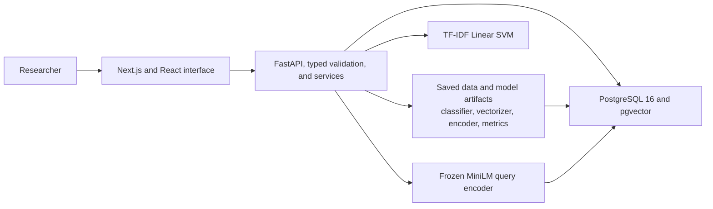

# PaperLens — Research Paper Intelligence Engine

PaperLens is a research-paper discovery and classification application backed by measured classical and neural NLP experiments. It classifies computer science papers, retrieves related records, and exposes the saved results through a web interface.

## Project overview

Research collections are large and span overlapping topics. PaperLens applies text representations and model families to organize papers into broad research classes and retrieve records relevant to a natural-language query. The implemented system includes dataset inspection, leakage-safe experiments, measured comparisons, and a database-backed web application.

PaperLens is a research-paper discovery and classification system. It is not a chatbot, does not generate paper summaries, and does not claim to identify research gaps or assess research quality.

## Key capabilities

- Browse and filter a database-backed collection of research papers.
- Classify a title and abstract with the saved validation-selected TF-IDF Linear SVM.
- Search papers with TF-IDF or 384-dimensional MiniLM embeddings ranked through pgvector.
- Inspect each paper's source metadata and original label.
- Compare saved classification and retrieval experiments.
- Explore results through a responsive six-page interface.

## Dataset

The project uses [`vrajpat3ll/arxiv-cs-papers`](https://huggingface.co/datasets/vrajpat3ll/arxiv-cs-papers), revision `c5523dff308d7d87c2f44f33ac3b898d0514a281`. The source split contains **20,000** records. Validation and cleaning selected **19,999** records for the project.

| Split | Records |
|---|---:|
| Train | 15,999 |
| Validation | 2,000 |
| Test | 2,000 |
| **Selected total** | **19,999** |

The six original fields are retained: `arxiv_id`, `title`, `abstract`, `primary_cat`, `all_cats`, and `label`. The numeric mapping is unchanged:

| Label | Category | Selected records |
|---:|---|---:|
| 0 | Algorithms | 4,999 |
| 1 | NLP/AI | 5,000 |
| 2 | Systems/Infra | 5,000 |
| 3 | Vision | 5,000 |

The data pipeline validates required fields and labels, detects duplicates using normalized identifiers and normalized title–abstract pairs, and writes derived data without changing the cached source. It found one duplicate title–abstract pair and excluded one record. The retained records were split by class with seed 42 at approximately 80/10/10; detected duplicate groups do not cross splits. The split is reproducible and stratified, but the balanced source and selected sample do not represent real-world arXiv category prevalence.

## Machine learning and NLP methodology

Paper title and abstract text is normalized with Unicode NFKC, whitespace collapsing, and case folding. The tokenizer extracts Unicode alphanumeric tokens and retains internal apostrophes. The default path does not remove stopwords, stem, or lemmatize; those are optional preprocessing comparisons.

Classical representations include Bag of Words and TF-IDF with unigram and bigram features. Word2Vec uses a 100-dimensional CBOW model trained on training text; document representations are means of in-vocabulary token vectors. The text vectorizers and learned representations are fit on training data only.

The evaluated classifiers include Multinomial Naive Bayes, Logistic Regression, and Linear SVM for sparse features; a Word2Vec-plus-Logistic-Regression baseline; PyTorch RNN, LSTM, GRU, BiLSTM, and BiLSTM with attention; a custom PyTorch Transformer encoder; and a fine-tuned MiniLM classifier. Neural sequence models use the training-derived vocabulary and a 290-token sequence length. The custom Transformer implements its own positional encoding, Q/K/V projections, multi-head attention, masks, residual blocks, and classifier head.

The fine-tuned classifier and semantic embedding model are separate experiments. DistilBERT was considered but was not fine-tuned because its checkpoint could not be accessed in the development environment. The locally available [`sentence-transformers/all-MiniLM-L6-v2`](https://huggingface.co/sentence-transformers/all-MiniLM-L6-v2) was used instead: it is fine-tuned for classification in one experiment and kept frozen for 384-dimensional retrieval embeddings in another.

Retrieval compares TF-IDF cosine similarity, Word2Vec document-vector similarity, and MiniLM cosine similarity. Evaluation reports Precision@5, judged Recall@5, MRR@5, and nDCG@5. Similarity and decision scores are ranking or margin values, not probabilities.

## Experimental results

The table reports the saved validation macro F1, test accuracy, and test macro F1 for all 13 classifiers, evaluated on the same 2,000-record test split.

| Model | Validation macro F1 | Test accuracy | Test macro F1 |
|---|---:|---:|---:|
| BoW + Logistic Regression | 0.9485 | 0.9405 | 0.9405 |
| BoW + Naive Bayes | 0.9425 | 0.9275 | 0.9276 |
| TF-IDF + Logistic Regression | 0.9475 | 0.9395 | 0.9396 |
| TF-IDF + Naive Bayes | 0.9475 | 0.9295 | 0.9296 |
| **TF-IDF + Linear SVM** | **0.9580** | **0.9520** | **0.9520** |
| Word2Vec + Logistic Regression | 0.9209 | 0.9055 | 0.9055 |
| BiLSTM + Attention | 0.9360 | 0.9280 | 0.9280 |
| BiLSTM | 0.9202 | 0.8930 | 0.8925 |
| GRU | 0.9356 | 0.9200 | 0.9200 |
| LSTM | 0.9216 | 0.8970 | 0.8972 |
| RNN | 0.7366 | 0.7225 | 0.7245 |
| Custom Transformer | 0.9330 | 0.9285 | 0.9284 |
| Fine-tuned MiniLM | 0.9535 | 0.9505 | 0.9504 |

The TF-IDF SVM was selected using validation macro F1. The comparison summarizes the recorded experiment results. Test results describe this dataset and split; they do not establish general superiority, and timing scopes vary across model families.

| Retrieval method | Precision@5 | Judged Recall@5 | MRR@5 | nDCG@5 |
|---|---:|---:|---:|---:|
| TF-IDF | 0.9333 | 0.5648 | 1.0000 | 0.7801 |
| Word2Vec | 0.9333 | 0.5602 | 1.0000 | 0.8249 |
| MiniLM cosine | 0.1333 | 0.0787 | 0.5000 | 0.1844 |

Retrieval evaluation uses **three queries and 27 assistant-assessed relevance judgments** that were not human-reviewed. The judgment pool came from earlier TF-IDF and Word2Vec candidate lists; unjudged results count as nonrelevant in the inherited metrics. These measurements are exploratory and are not a complete-corpus relevance benchmark.

## System architecture



PostgreSQL stores paper metadata, operational split membership, experiment projections, and MiniLM vectors. The application uses the saved TF-IDF classifier, TF-IDF representation, and cached MiniLM encoder. Saved experiment JSON artifacts are the authoritative source for the comparison view. Docker Compose defines the database, API, and frontend services.

## Technology stack

| Area | Technologies |
|---|---|
| Languages | Python, TypeScript, JavaScript, SQL, CSS |
| Machine learning and numerical computing | NumPy, SciPy, scikit-learn, Gensim |
| NLP and pretrained models | Hugging Face Datasets, Transformers, Sentence Transformers, NLTK |
| Deep learning | PyTorch |
| Backend | FastAPI, Pydantic, SQLAlchemy, Uvicorn, Psycopg |
| Frontend | Next.js, React |
| Database | PostgreSQL 16, pgvector |
| Infrastructure | Docker, Docker Compose |
| Testing and quality | Python `unittest`, Vitest, Playwright, axe-core, ESLint, TypeScript checks |

## Application pages

1. **Home** — Collection counts and entry points to discovery, classification, search, and experiment results.
2. **Browse Papers** — Paginated database-backed records with text search and category filtering.
3. **Paper Details** — The original six dataset fields and the operational split for an individual paper.
4. **Classification** — A title-and-abstract form with the saved model prediction and score margins.
5. **Semantic Search** — TF-IDF or MiniLM retrieval with ranked database records and method-appropriate scores.
6. **Experiment Comparison** — Saved classification and retrieval results, with evaluation caveats.

## Project structure

```text
.
├── backend/
│   └── app/
│       ├── db/              # PostgreSQL repository, ingestion, migrations
│       └── services/        # Classification, retrieval, experiment services
├── frontend/
│   ├── app/                 # Six Next.js routes and shared components
│   ├── scripts/             # Production standalone preparation
│   └── tests/               # Component, API, and browser journeys
├── ml/
│   ├── data/                # Dataset validation, cleaning, and splitting
│   ├── evaluation/          # Metrics, comparisons, and figures
│   ├── models/              # Classical, recurrent, attention, pretrained models
│   ├── preprocessing/       # Normalization, tokenization, vocabulary
│   ├── representations/    # BoW, TF-IDF, Word2Vec, sequences
│   └── retrieval/           # Sparse, Word2Vec, and Transformer retrieval
├── tests/                   # Data, model, retrieval, and backend suites
├── docker-compose.yml
└── README.md
```

## Verification

The final local verification recorded:

- **Backend Python tests:** 35 passed, including live PostgreSQL and HTTP API integration checks.
- **Data, model, and retrieval regressions:** 61 passed across the Python suites.
- **Frontend:** TypeScript check and ESLint passed; Vitest **7 passed**.
- **Production build:** Next.js build passed and generated all six routes.
- **Browser tests:** Playwright **8 passed**; axe reported **zero WCAG 2.1 A/AA violations** across the six routes.
- **Live application:** PostgreSQL, backend, and frontend reached healthy status. Chrome verified database-backed browsing and detail, filtering, classification, both retrieval methods, experiment comparisons, reload, and recovery through the paper page's retry control.

Playwright isolates parts of the interface with deterministic fixtures; its classification journey is mocked. The saved classifier and both retrieval methods were also verified separately through the live API and Chrome. The automated results establish the tested contracts and journeys, not broad real-world model performance.

## Project status

The model experiments, evaluation records, database-backed API, and web application have completed local verification. The application preserves the original dataset labels and uses the saved model and evaluation artifacts.

## License and attribution

The dataset card for [`vrajpat3ll/arxiv-cs-papers`](https://huggingface.co/datasets/vrajpat3ll/arxiv-cs-papers) identifies the dataset as CC BY 4.0 and attributes its records to the arXiv API. The local snapshot records collection on 2026-03-12 and source-side class balancing by random undersampling. Check individual paper terms before redistribution.

The upstream [`sentence-transformers/all-MiniLM-L6-v2`](https://huggingface.co/sentence-transformers/all-MiniLM-L6-v2) model is Apache-2.0. Retain its upstream attribution and license notice when redistributing upstream or fine-tuned weights, and identify the project checkpoint as fine-tuned. Optional lemmatization uses Princeton WordNet 3.0, which has separate upstream terms.

No project-wide license file is present; this repository does not declare a project license.
